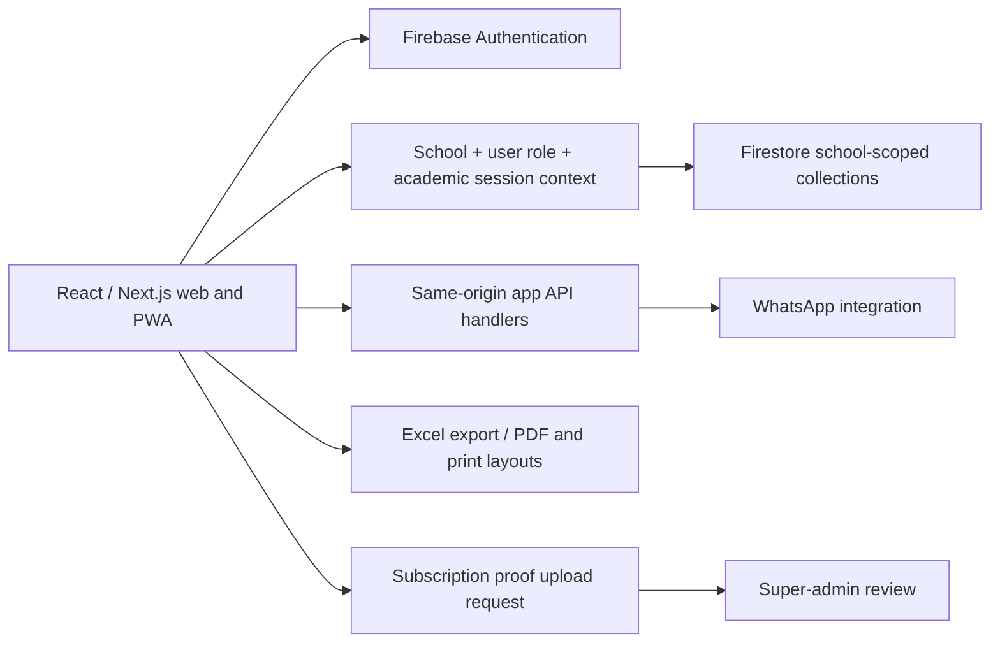

# SchoolApp.pk — Product and Technical Research

Research date: **29 October 2026 (Asia/Karachi)**. Target: https://www.schoolapp.pk/.

## Roman Urdu reading note

Is file mein tamam 29 advertised modules ko actual dashboard ke saath compare kiya gaya hai. Har feature ke saath bataya gaya hai ke woh practical test hua, sirf screen/code mein mila, marketing claim hai, ya abhi verify nahi hua. Free/paid pricing section 3 mein, tech stack section 4 mein, detailed features section 6 mein aur pending checks section 11 mein hain. Paid plan ya real messaging ke liye koi payment/message nahi kiya gaya.

## 1. Scope and evidence rules

This is a competitor research dossier for designing our school management SaaS. It records the reference product's behavior, not a claim that every advertised feature works. No implementation of our product has started.

Evidence labels used throughout:

- **TESTED**: an action completed in our own trial school and its result was observed.
- **UI**: screen, form, option or preview inspected while authenticated; complete persistence or delivery not yet tested.
- **CODE**: evidence from JavaScript/CSS publicly delivered by the site; runtime behavior is not guaranteed.
- **ADVERTISED**: present in public marketing or pricing; not demonstrated in the trial.
- **PLACEHOLDER**: explicit coming-soon/demo content or a non-operational surface.
- **UNVERIFIED**: needs an additional account, paid entitlement, integration or further testing.

The account is **AddizTech Research School**, subdomain `addiztech-research-261029`, admin display name AddizTech. The user supplied the registration mobile number. Credentials are kept separately in a local ignored file and must not be copied into this dossier. Only invented students and accounting entries were used. No real payment, paid upgrade, WhatsApp message or support ticket was sent. The browser declined download authority for the Excel export; export file verification remains blocked.

Important counting distinction: the homepage advertises **29 modules**. The school-admin sidebar contains **24 navigation destinations**, including dashboard, subscription, settings and support. Settings has **8 tabs**. These counts describe different things; they must not be added together as a feature count. The inventory below splits modules into smaller capabilities.

## 2. Executive findings

1. This is a Next.js/React application on Vercel with Firebase Authentication and Firestore client integration. It is not evidenced as a PHP/Laravel/MySQL application.
2. The free offer is a **time-limited trial**, not an advertised permanent free plan. Pricing/signup say **3 days / 10 students**. Our actual subscription screen says **14 days remaining / 10 students**. The registration bundle also sets a 14-day expiry.
3. Public paid plans run from **PKR 5,000 to 15,000 per year**, with 150–1,200 student limits; Enterprise is custom priced.
4. Core admissions, teacher creation, attendance, fee structures, monthly invoices, partial receipts, expense accounting, exam/results, library inventory, family confirmation and document previews were exercised with dummy data.
5. Financial features include: opening balances, class-based fee structures, per-student concessions, FIFO allocation, passbooks, receipt numbers and daily cashier handover.
6. Marketing overstates demonstrated breadth. The timetable displays sample staff/subjects; several parent features have coming-soon messages in the client; multiple marketed learning/branch/payment modules have no demonstrated operational workflow.
7. Paid subscription activation uses manual payment proof and super-admin review. This is distinct from collecting student fees.
8. Messaging shows mixed implementations: official Meta Cloud API settings coexist with a notifications screen asking for a local `WhatsApp.bat` service. Successful delivery is unverified.
9. Several direct page loads produced `No school selected` console errors and empty initial data. Internal navigation and waiting for loading improved results. This is an observed initialization issue, not proof that all affected modules are broken.

## 3. Pricing: free versus paid

Sources: [public pricing](https://www.schoolapp.pk/#pricing), [signup](https://www.schoolapp.pk/signup), [authenticated subscription page](https://www.schoolapp.pk/subscription). Prices observed on the research date; taxes, renewal policies and integration charges are not established.

| Plan | Listed price | Student limit | Published inclusions / differentiators | Evidence |
|---|---:|---:|---|---|
| Free Trial | PKR 0; advertised 3 days | 10 | Shared domain, core modules, UI/UX claim | UI; actual new account received 14 days |
| Starter | PKR 5,000/year | 150 | Student promotion, shared domain, WhatsApp notifications | UI + advertised |
| Basic | PKR 7,500/year | 300 | Student promotion, shared domain, advanced accounting | UI + advertised |
| Standard | PKR 10,000/year | 500 | Student promotion, shared domain, complete cloud ERP; popular badge | UI + advertised |
| Plus | PKR 12,500/year | 800 | Student promotion, shared domain, priority support | UI + advertised |
| Premium | PKR 15,000/year | 1,200 | Student promotion, shared domain, dedicated account manager | UI + advertised |
| Enterprise | Custom/year | Unlimited, as advertised | Custom domain, white-label mobile app, 24/7 priority support | UI + advertised; delivery unverified |

**Do not interpret these short pricing cards as an exhaustive entitlement matrix.** They do not establish that accounting is blocked on Starter, or that WhatsApp is unavailable on Free Trial. Our free trial could open accounting, ID cards, certificates, settings, reports and the other school-admin pages. In particular, the ID-card page uses the label “Premium Studio” while remaining accessible in the trial; this label is not evidence of a Premium-plan restriction.

### 3.1 Trial and upgrade behavior

- Trial usage screen displays current plan, expiry countdown, student count, allowed limit and utilization percentage. **UI**.
- Trial creates a school, school settings, one approved admin, a default academic session and default classes. **TESTED/CODE**.
- Public offer: 3 days. Created school: 14 days. **Confirmed mismatch**.
- Upgrade button opens a request form with sender name, mobile and payment screenshot. **UI**.
- Payment methods shown for SaaS subscription: EasyPaisa, JazzCash and Meezan Bank. **UI**.
- Submission requires payment proof; request history has pending, approved and rejected states. **UI/CODE**; no request submitted.
- Expiry screen and renewal banners are present in the client. **CODE**; actual expiry not time-tested.
- Student-limit checking exists in delivered CRUD code. **CODE**; the 11th active student boundary has not been tested.
- No verified evidence for automatic card billing, automatic subscription reconciliation, refunds, invoices for SaaS tax purposes or prorated upgrades.

## 4. Technical stack and how it works

### 4.1 Evidence-backed stack

| Layer | Finding | Evidence / qualification |
|---|---|---|
| Web framework | Next.js, App Router | `X-Powered-By: Next.js`, `/_next/static/chunks/`, React Server Component payload, App Router client code |
| Delivered framework version | Next.js **16.2.4** | Public bundle contains `window.next={version:"16.2.4",appDir:!0}`; version of this deployed client, not a dependency lockfile audit |
| UI runtime | React / React DOM | Framework bundles and React symbols |
| Delivered React version | **19.3.0-canary-3f0b9e61-20260317** | Runtime version string in delivered React/React DOM bundles |
| Styling | Tailwind-style utility CSS; Tailwind strongly evidenced | `--tw-*`, layers and utility classes throughout compiled CSS; exact Tailwind version not established |
| Hosting | Vercel | `Server: Vercel`, `X-Vercel-Cache`, `X-Vercel-Id` headers |
| Build pipeline | Turbopack build artifacts | Public `turbopack-...js` runtime; exact build configuration unknown |
| Authentication | Firebase Authentication | Firebase auth SDK, sign-in/register functions, Google sign-in UI and observed created auth identity |
| Application database | Cloud Firestore integration | Firestore document/collection functions and school-scoped CRUD code; settings and records persisted in our trial |
| State management | React context providers | `AuthProvider`, `SchoolProvider`, `SubdomainProvider`, active session switching |
| Local client cache | localStorage | Auth-user and school-settings caching in app code; cached data is not proof of server authorization |
| Charts | Recharts | `recharts-*` components/strings and rendered dashboard charts |
| Spreadsheet import/export | SheetJS / XLSX | Delivered SheetJS library and `XLSX.writeFile` usage; UI accepts CSV/XLS/XLSX in relevant import components |
| PDF tools | jsPDF integration | `jspdf` in public lazy-loaded PDF bundle; also browser print layouts |
| Fonts/icons | Google Lexend, Material Symbols; SVG icons | Linked Google font CSS, named symbol classes and SVG controls |
| PWA | Manifest, service worker, per-school branding | `/manifest.json`, `/sw.js`, dynamic manifest/icon routes and installable-web-app metadata |
| Push messaging | Firebase Messaging integration | Client messaging token/permission handling; background delivery not proven |
| WhatsApp | Meta Cloud API UI + custom app API routes | `/api/whatsapp/verify`, `/api/whatsapp/send` referenced; a separate local-server path is also exposed in UI |
| Backend API style | Same-origin `/api/...` handlers | Auth/mobile lookup, staff/parent account creation, messaging and manifest endpoint references; server implementation not accessible |
| Source language | Not conclusively established | Browser-delivered JavaScript does not prove whether original sources were TypeScript or JavaScript |
| File/object storage | Not conclusively established | Upload interfaces exist; provider, retention and storage security not verified |

Exact Node.js version, Firebase SDK version, database rules, backup design, server libraries, hosting bill, queue system, cron scheduler, SMS provider and payment-gateway backend remain unknown. Do not invent Prisma, PostgreSQL, MySQL, MongoDB, Redis, Docker or a native mobile framework.

### 4.2 Observed architecture

Tenant selection uses an authenticated user's `schoolId` and a subdomain context. Public code refers to `schools/{schoolId}/config/settings` and school-scoped record paths. The school slug is checked for uniqueness during registration. The session starts in April by default; our initial session is **2026-04-01 to 2027-03-31**.

Mobile login is backed by a generated email-like Firebase identity. That does not establish SMS OTP login; signup showed mobile + password, not an OTP challenge. Google sign-in is an alternative button; its full onboarding flow was not exercised.

Client role checks and school-scoped collection paths do **not** prove secure server-side tenant isolation. Firestore rules, API authorization, audit immutability, token storage and cross-tenant security have not been audited.

## 5. Authentication, onboarding and access

| Capability | Workflow / detail | Status |
|---|---|---|
| Register school | Choose plan; school name, unique slug, mobile, admin name, password, confirmation; address optional | TESTED |
| Slug validation | Lowercase letters, digits, hyphens; availability check in registration code | UI/CODE |
| Mobile validation | Pakistani mobile format; duplicate-mobile check referenced | UI/CODE; duplicates not tested |
| Password validation | Minimum 6 characters; confirmation matching | UI/CODE |
| Login | Mobile or email + password; password visibility control | UI; auto-login after signup TESTED |
| Google login | Google sign-in option | UI; not completed |
| Forgot password | Modal asks for registered mobile and routes verification/contact to WhatsApp support | UI; no recovery request sent |
| Default setup | 13 classes: PlayGroup, Nursery, KG, 1st–10th; section A appears initially | TESTED |
| School-specific access | Slug plus school ID context and school branding | CODE/UI; wildcard subdomain behavior unverified: one request to our school hostname failed TLS negotiation (unexpected EOF); no certificate checks were bypassed |
| Role-based navigation | Admin, principal, teacher, accountant, student, parent and superadmin role names | CODE; only admin session tested |
| Staff accounts | Add name, mobile/email, password and Teacher/Accountant/Principal/Administrator role | UI; no extra auth account created |
| Account approvals | Pending/approved users, approve/revoke/remove controls | UI/CODE; permission changes not tested |
| Log out | Present in admin and parent layouts | UI |

### 5.1 Roles from the delivered navigation configuration

This table records **client navigation configuration**, not independently verified backend permission enforcement.

| Area | Roles listed in client |
|---|---|
| Dashboard | Superadmin, admin, principal, teacher, student, parent, accountant |
| Students, classes, attendance, exams | Admin, principal, teacher |
| Teachers and staff attendance | Admin, principal |
| Results | Admin, principal, teacher, student, parent; page-level wrapper may be narrower |
| Fees | Admin, principal, accountant |
| Fee structure | Admin |
| Promotion | Admin, principal |
| Library | Admin, principal, teacher, student |
| Timetable | Admin, principal, teacher, student, parent |
| Reports | Admin, principal, accountant |
| Accounting | Admin, accountant |
| Birthdays, ID cards, certificates, parent management | Admin, principal |
| Families | Admin, principal, accountant |
| Notifications and support | Admin, principal |
| Subscription and settings | Admin |
| Platform administration | Superadmin |

## 6. Detailed school-admin feature inventory

Sources for each group are the corresponding [authenticated dashboard](https://www.schoolapp.pk/dashboard) sidebar destination and its publicly delivered page bundle, archived under `research/schoolapp/evidence/`.

### 6.1 Dashboard and search — `/dashboard`

- **UI**: total students and teachers; monthly/yearly collected and pending fees; monthly concessions; expenses; net profit; recovery percentage; overdue dues; today's receipts; student/teacher attendance; monthly attendance average; salaries due.
- **UI**: income/expense chart, fee collection breakdown, profit trend and monthly comparison charts.
- **UI/CODE**: cards link to filtered operational pages rather than acting only as static numbers.
- **UI**: quick access to admissions, fees, attendance, exams, staff, messaging, notices, timetable, settings and reports.
- **TESTED final dashboard**: 2 students, 1 teacher, monthly/yearly collection Rs 700, pending/overdue Rs 1,800, monthly expense Rs 100, net profit Rs 600, recovery 28%, student attendance 50%, one absent student, teacher attendance 1/1 (late counted as attended), salary due Rs 10,000.
- **UI**: global search field for students/teachers/classes, header academic-session selector, help and notification controls.
- **UI/CODE**: customizable card visibility and three theme choices under Settings.
- **CODE**: smart alerts for missing phone/DOB/photo, birthdays, defaulters, unpaid invoices and unconfirmed families.
- **UNVERIFIED**: correctness of every chart aggregation and real notification history. Typing Research in the global search produced no visible matching-record suggestions despite matching created students/teacher; search functionality is not established. Header client code contains sample notification text; do not assume all header entries are live events.

### 6.2 Students and admissions — `/students`

- **TESTED**: create student, required name/father/class/roll/admission date; optional contact details.
- **TESTED**: auto-sequenced school-wide admission numbers `ADM-2026-001`, `ADM-2026-002`.
- **UI**: next class roll number suggestion; manually set rolls were accepted.
- **UI**: class/section, DOB, gender, phone/email, address, blood group, previous school, nationality, admission date and photo.
- **TESTED**: opening balance field; Rs 500 on Student A appeared in student list, invoices and family balance.
- **UI**: Active/Discharged list filters; record form also offers On Leave and Graduated.
- **UI**: class filters, name/roll/admission search, sorting/pagination table controls.
- **UI/CODE**: spreadsheet template, CSV/XLSX/XLS import with field mapping/validation, Excel export and print summary.
- **UI**: edit record, photo update, performance/history action, credential/key action and discharge control.
- **UNVERIFIED**: import edge cases, duplicate roll/admission enforcement, discharge/re-admission and photo upload persistence.

### 6.3 Teachers and HR directory — `/teachers`

- **UI**: teacher list, search, add/edit/remove, template/import/export.
- **TESTED**: Research Teacher created in Research Department with Rs 10,000 salary; record appeared as Active.
- **CODE/UI**: first/last name, employee ID, CNIC, gender, DOB, phone/email/address, department, designation, qualification, specialization, subjects, joining date, salary and status.
- **UNVERIFIED**: whether a teacher directory record creates a login automatically; a separate staff-user form exists, so do not assume they are the same operation.
- **ADVERTISED/CODE**: payroll; salary fields and salary-due dashboard are evidenced, but a complete payslip/deduction/disbursement workflow is not demonstrated.

### 6.4 Classes and sections — `/classes`

- **UI/TESTED setup**: 13 seeded classes with section A, class/section/student summary counts.
- **UI**: add/edit/delete class, sections and class-teacher assignment described by the screen.
- **UNVERIFIED**: class deletion with enrolled students, section capacity, teacher conflicts and multi-shift scheduling.

### 6.5 Student attendance — `/attendance`

- **UI**: daily/monthly/annual tabs; class, section and date filtering.
- **TESTED action**: selected class 1st, marked Student B absent; Student A remained present. Screen showed 2 students / 1 present / 1 absent, with save/autosave behavior.
- **UI**: present/absent/late/leave status and Save All.
- **UI**: absent notification action and no-phone guard; no parent message sent.
- **UNVERIFIED**: annual totals and absent-message delivery. Reopening daily attendance preserved 1 present / 1 absent; monthly summary showed 1 active day, average present 1, average absent 1 and 50% attendance. Daily/monthly persistence is TESTED.
- **OBSERVED issue**: default all-student view initially showed zero; selecting class 1st populated the two records. Direct navigation also generated readiness errors elsewhere.

### 6.6 Staff attendance — `/teacher-attendance`

- **UI**: daily/monthly/annual views, date selector and present/absent/late/leave counts.
- **UI**: designation column and Save All.
- **TESTED**: newly created teacher appeared, was marked Late; counters became 0 present / 1 late and UI confirmed all changes saved.
- **UNVERIFIED**: reload persistence, time-in/out, biometric integration, leave balance, payroll linkage. Marketing's “time tracking” is not enough to confirm these.

### 6.7 Exams — `/exams`

- **TESTED**: create **Research October Test**, 29 October 2026, Monthly, class 1st, Mathematics, 100 marks, Upcoming.
- **UI**: exam types Monthly/Midterm/Final/Quiz, date/total marks, status Upcoming/In Progress/Completed.
- **UI**: multi-class selection, select all, add/remove subject chips, edit/delete and enter-results action.
- **UI**: status counters and type/status filters.
- **UNVERIFIED**: per-subject dates/times, printable datesheet, roll-number slips and exam seating; these are advertised separately.

### 6.8 Marks and results — `/results`

- **UI**: choose exam and class; student/subject marks grid.
- **TESTED UI calculation**: 85/100 showed grade A; 45/100 showed grade E. Reopening the exam preserved both marks. Summary showed two passed students, 65% average and 85% highest. Persistence is TESTED.
- **CODE**: result summary counts, averages, highest percentage, pass/fail calculation.
- **UNVERIFIED**: customizable grading policies and publish/lock moderation. Report-card code shows a different printed grading scale with F below 50; this may disagree with the results entry grade E and needs targeted reconciliation.

### 6.9 Fee structures — `/fee-structure`

- **TESTED**: created **Research Monthly Tuition**, class 1st, monthly, PKR 1,000, zero late fine; persisted and appeared in fee generation.
- **UI**: all/selected/single-class applicability and class-specific amount overrides.
- **UI**: categories Tuition, Transport, Exam, Lab, Library, Sports, Other.
- **UI**: Monthly/Quarterly/Annually/One-time frequencies; due day, late fine, description.
- **UI**: add/edit/delete; totals by structures/categories/monthly amount.
- **UNVERIFIED**: automatic scheduling, fine accrual, proration and once-per-session frequency enforcement.

### 6.10 Fee invoices, collections and ledger — `/fees`

- **TESTED**: bulk generation for October 2026/class 1st using a selected structure, two invoices of Rs 1,000 each.
- **UI**: per-student discount entry when selecting a fee structure.
- **UI**: custom invoice and additional/advance collection paths.
- **TESTED**: Student A invoice combines Rs 1,000 current fee + Rs 500 opening dues = Rs 1,500 due.
- **TESTED**: collect Rs 700 as dummy cash; system issues `RCP-1001`, marks invoice Partial and reports Rs 800 remaining for Student A.
- **UI/TESTED allocation preview**: oldest-first allocation; advanced manual per-fee allocation available.
- **UI**: Cash, Bank Transfer, Online and Cheque accounting methods; a method label is not proof of gateway integration.
- **UI**: payment date, waivers/concessions, invoice edit, payment history/passbook and audit-related actions.
- **UI**: current month/year filters, class filter, Paid/Partial/Unpaid/Discount filters, roll/name/challan quick search.
- **UI**: per-student ledger, batch unpaid printing, reminders, receipt/voucher and three-part challan print controls.
- **TESTED**: daily daybook shows one cash receipt, Rs 700 in drawer, zero bank transfer and Rs 700 handover; printable handover control available.
- **UI/CODE**: void/reset payment and invoice delete paths; not executed.
- **CODE**: receipt/invoice counters, fee transactions, FIFO credit allocation and student audit logs.
- **UI**: legacy invoice migration button is exposed inside Generate; not executed.
- **OBSERVED UX defect**: before selecting any structure, generation view claimed all two invoices were already generated despite zero existing invoices; checking a structure revealed the valid generation path.
- **OBSERVED reconciliation risk**: after payment, monthly pending KPI was Rs 1,300 while total balance due was Rs 1,800, with Rs 500 opening balance explaining the difference. Labels should make this distinction explicit in our design.
- **UNVERIFIED**: overspecified discounts, duplicate receipt concurrency, cancellation reversals, period lock, all cash/bank reconciliation cases and actual print/PDF outputs.

### 6.11 Financial accounting — `/accounting`

- **UI**: Summary, Income, Expenses and Report tabs, year/month filters.
- **UI**: income, expense, pending-fee, profit/loss KPIs; monthly comparison and category breakdown charts.
- **TESTED**: Rs 700 receipt became automatic fee income. Added a Rs 100 dummy expense (Miscellaneous); summary then showed income Rs 700, expenses Rs 100, net profit Rs 600 and pending fees Rs 1,800.
- **CODE**: fee collections feed income automatically; other-income and expense records can be added/edited/deleted.
- **CODE**: category, amount, paid-to/received-from, payment method, receipt/date and description fields.
- **CODE/UI**: annual report, detailed monthly table, Excel/PDF export and print.
- **UNVERIFIED**: double-entry bookkeeping, chart of accounts, bank reconciliation, accrual vs cash basis, tax reporting and full payroll. Do not equate the advertised accounting module with an audited accounting package.

### 6.12 Academic promotion — `/promotion`

- **UI**: active session and class selection.
- **UI**: class 1st loaded both checked students with A due Rs 800 and B due Rs 1,000, suggested target 2nd, editable roll numbers and repeat-class choice. No destination-session control was visible in the inspected promotion table.
- **CODE**: promotion/dues handling exists; actual destination-session carry-forward is not yet demonstrated.
- **UNVERIFIED**: end-to-end promotion, rollback, duplicate promotion guards, graduation, prior-session immutability. Do not mutate session history until these are deliberately tested.

### 6.13 Library — `/library`

- **UI**: book inventory, total/available/issued/overdue counts, Add Book.
- **TESTED**: Research Library Book by Research Author, shelf TEST-A1, one total/available copy persisted.
- **OBSERVED**: only edit/delete actions were available on the book row. No borrower, issue or return action was found; public page code likewise showed inventory fields. Lending is not established by the page subtitle.
- **UNVERIFIED**: issue/return transaction persistence, late fines, barcode scanning and parent borrowing visibility.

### 6.14 Timetable — `/timetable`

- **UI**: weekly Monday–Saturday grid, class 5th–10th and section A/B selectors, time slots, subjects, staff and rooms.
- **PLACEHOLDER/observed**: fresh empty school showed named sample teachers, subjects and rooms without creating staff. No demonstrated timetable editor was present in the inspected screen.
- **CODE**: parent portal explicitly labels its timetable a demo.
- **UNVERIFIED**: editable school schedule, conflict detection, cover periods, shifts and published teacher timetables.

### 6.15 Reports — `/reports`

- **UI**: 10 report tabs: Attendance, Fees, Performance, Overview, Monthly Summary, Fee Aging, Attendance Defaulters, Toppers, Income & Expense, Report Card.
- **UI/CODE**: Excel export; charts for attendance trends, collections, class performance and gender distribution.
- **CODE**: aging buckets, absence threshold (3+ absences), topper percentages and monthly financial details.
- **CODE**: per-student report card combines personal profile, attendance, exam results and fee ledger; English/Urdu, bulk print and individual print controls.
- **TESTED**: Student A combined report showed 100% attendance, 85 marks/A, Rs 700 total paid and Rs 800 due. Monthly report showed Rs 2,000 billed, Rs 700 collected, Rs 1,300 current outstanding, 50% attendance and two students.
- **OBSERVED defect**: Toppers reports Student B at 45% as grade C, whereas Results reports E. Fee Aging buckets sum to Rs 1,300 but total due is Rs 1,800; opening arrears are outside visible aging buckets.
- **BLOCKED export check**: browser download authority was declined during Excel export. No exported file was obtained or inspected; no alternate download path was attempted.
- **UNVERIFIED**: complete export files and Unicode/Urdu print rendering.

### 6.16 Birthdays — `/birthdays`

- **UI**: today/week/month totals; All/Today/This Week/By Month and Students/Teachers filters; wishes workflow.
- **OBSERVED failed test**: entered DOB 2016-10-29 on Student A, verified it in the edit form, clicked Update Student and waited for the modal to close. Reopening the record showed the DOB empty; Birthday Center remained zero. This could be an application persistence issue or a date-input automation interaction; root cause is not established. Birthday matching/delivery must remain unverified.
- **UNVERIFIED**: DOB-year handling, leap dates, scheduled wishes and actual message delivery.

### 6.17 ID card studio — `/id-cards`

- **UI**: choose class, load students, preview sheets, theme and portrait/landscape controls described by the interface.
- **UI/CODE**: QR settings and print-friendly student cards.
- **TESTED preview**: loaded class 1st; both students, school/session, father, class/section and admission/roll numbers appeared. Switched to portrait and Emerald theme; A4 portrait preview updated. Four themes: Royal Navy, Emerald, Teal, Ruby; QR and principal-signature switches.
- **UNVERIFIED**: QR content, batch page breaks, exact card sizes and printed output.
- Accessed in Free Trial despite “Premium Studio” product label.

### 6.18 Certificates — `/certificates`

- **TESTED preview**: selected Student A and inspected Character, Leaving and Appreciation modes. Only these three mode buttons were present; an additional academic certificate type was not established.
- **CODE**: auto-populated identity, DOB, roll/admission number; issue date/principal/address and editable conduct/reason/body text.
- **UI/CODE**: live preview and A4 landscape printing with signatures.
- **OBSERVED defect**: Character/Leaving previews contained literal dollar prefixes such as `$Master`, `$his`, `$Son of`; Leaving showed DOB as a dash; later edit/reopen testing also showed DOB was not retained in this run.
- **UNVERIFIED**: complete print outputs, certificate numbering and verifiable issuance records.

### 6.19 Family billing — `/families`

- **TESTED**: two students sharing father name **Research Guardian** produced one suggested family.
- **TESTED**: consolidated billed Rs 2,500, paid Rs 700, due Rs 1,800; child breakdown Rs 800 + Rs 1,000.
- **TESTED**: Confirm Family changed the group from suggested to confirmed.
- **UI/CODE**: add/remove child, disband family, parent-auth creation path and messages.
- **IMPORTANT**: matching father's name is only a suggestion; same-name parents can be unrelated. Do not treat the suggestion as authoritative identity matching.
- **UNVERIFIED**: cross-family moves, combined receipt allocation and automatic parent credentials/delivery.

### 6.20 Parent management — `/parents`

- **UI**: Parent Accounts, Leave Requests, Broadcast Announcements tabs.
- **TESTED read**: family appears with both dummy children; missing-phone guard prevents account creation until a phone is supplied.
- **UI/CODE**: individual/bulk parent account generation, login PIN, last login, phone update, resend PIN and direct message.
- **CODE**: leave approve/reject and broadcast message flow.
- **UNVERIFIED**: parent login, authorization across children, leave persistence and PIN delivery. No phone was assigned to dummy children and no message sent.

### 6.21 Notifications — `/notifications`

- **UI**: compose title/message, class targeting, WhatsApp/in-app/both choices, recent notifications and active/student-phone counts.
- **UI**: in-app marked active; WhatsApp reports disconnected and asks for `WhatsApp.bat`.
- **UNVERIFIED**: in-app persistence/read receipts, delivery retries, campaign throttling and SMS carrier integration.

### 6.22 Settings — `/settings`

Eight tabs inspected:

1. **School Info**: logo, school/principal/contact/address/city/email/website; academic start month; Corporate Blue/Neo-Brutalist/Dark Knight themes; 17 dashboard-card switches. Logo accepts PNG/JPG/SVG with 2 MB limit. **UI**.
2. **Academic Sessions**: create dated session, select active session, header session context. Existing session displayed an empty start-month label `()` in this account. **UI**; creation/switch not exercised.
3. **Receipt PDF**: receipt title/footer and switches for address, phone, father, roll, section, previous dues, discount, balance, paid amount, method and signature. **UI**.
4. **WhatsApp**: each school enters Meta Phone Number ID/access token; save/verify/test controls and setup guide. **UI**; no credentials entered.
5. **Messages**: six editable templates — fee reminder, fee receipt, absence, birthday, results, announcement. Variable chips, preview/save/reset. **UI**.
6. **Users**: staff creation, All/Staff/Parents filters, pending approvals and approved users. Roles Teacher/Accountant/Principal/Administrator. **UI**; no permission changes made.
7. **Smart Alerts**: scheduled student/staff attendance reminders, Friday fee summary, birthday reminder and custom reminder; missing data, dues and family badges. Low attendance under 75% is explicitly marked coming soon. **UI**.
8. **Parent Portal**: 13 feature switches: results, attendance, diary, notices, fees, timetable, teacher contact, profile, medical, library, transport, sports and push. **UI**. A switch's existence does not prove the corresponding module works.

The WhatsApp guide's claims about free conversations and absence of ban risk are vendor UI claims, **not independently verified Meta pricing or compliance guidance**. Do not use them as current integration requirements.

### 6.23 Support — `/support`

- **UI**: create ticket and view support history.
- **CODE**: subject/details, priority, Open/In Progress/Resolved state and super-admin replies.
- **UNVERIFIED**: SLA, attachment support and notification delivery. No dummy support ticket was submitted to the vendor.

### 6.24 Subscription — `/subscription`

See pricing/upgrade section. This page controls the school's payment to the SaaS vendor; it is separate from student invoice collection.

## 7. Parent portal and marketed learning features

Source: `/parent-portal` public page bundles and admin feature switches. A parent-authenticated session has **not** been tested.

| Capability | Evidence and state |
|---|---|
| Linked children / profile | CODE: guardian/student selection and profile; needs parent login test |
| Exam results | CODE: subject marks/results data loading |
| Attendance | CODE: student attendance display |
| Fees | CODE: fee records/history and remaining balance; payment gateway not proved |
| Diary/homework | CODE: diary fetching and display; no confirmed school-admin authoring workflow |
| Notices | CODE: noticeboard display |
| Leave applications | CODE: date range, reason, submit; admin approve/reject path exists |
| Timetable | PLACEHOLDER: client explicitly says demo timetable |
| Teacher communication | PLACEHOLDER: activation-soon message |
| Medical records | PLACEHOLDER: activation-soon message |
| Parent library | PLACEHOLDER: activation-soon message despite separate admin library module |
| Transport information | PLACEHOLDER: activation-soon message |
| Sports/activities | PLACEHOLDER: activation-soon message |
| Push notifications | UI switch/CODE messaging integration; delivery untested |

### 7.1 All 29 homepage modules reconciled

| # | Marketed module | What was actually found |
|---:|---|---|
| 1 | Admission management | Working dummy admissions |
| 2 | Attendance management | Operational UI; dummy status/save action exercised |
| 3 | Digital ID cards | Admin studio UI; print output not validated |
| 4 | Examination management | Dummy exam created |
| 5 | Datesheets and roll slips | Advertised; no working print flow established |
| 6 | Student certificates | Admin generator UI/code |
| 7 | Custom grading policy | Advertised; no editable policy confirmed; grade inconsistency needs testing |
| 8 | Homework | Parent diary data path; admin authoring not confirmed |
| 9 | Assignments | Advertised; separate working module not found |
| 10 | Video lectures | Advertised; separate working module not found |
| 11 | Lesson plans / syllabus | Advertised; separate working module not found |
| 12 | Worksheets | Advertised; separate working module not found |
| 13 | Fee vouchers | Working invoices/receipt; print controls inspected |
| 14 | Consumer-number collection | Advertised; no gateway transaction verified |
| 15 | QR / RAAST collection | Advertised; no live RAAST integration verified |
| 16 | Accounts/finance statements | Accounting UI and code |
| 17 | Profit/loss | Accounting dashboard/report code; not reconciled fully |
| 18 | Payroll | Salary fields/due KPI; full payroll workflow unverified |
| 19 | WhatsApp/SMS | Two messaging approaches visible; no actual delivery tested |
| 20 | Parent portal | Admin management plus parent client code; no parent session yet |
| 21 | Parent feedback/reviews | Advertised; working submission/moderation flow not found |
| 22 | Staff management | Teacher directory and staff auth are separate UI areas |
| 23 | Staff attendance | Operational screen; record persistence not tested |
| 24 | Software users/rights | User/role/approval UI and client role map |
| 25 | Multi-branch | Advertised; school tenancy is evidenced, branch hierarchy is not |
| 26 | Multi-shift | Advertised; no working shift-management interface demonstrated |
| 27 | Multi-session | Session settings/header; promotion code |
| 28 | Customer support | Ticket UI/code; SLA unverified |
| 29 | Video training | Advertised; training library not located in inspected navigation |

Do not confuse multi-school tenancy (separate customer schools) with multi-branch management (one customer controlling several campuses). The former has implementation evidence; the latter remains a marketing claim here.

## 8. Platform operator / super-admin

The school-admin account has no authority to inspect other schools. The following is **public client-navigation evidence only**, not a tested operator session:

- Platform dashboard, schools and users.
- Support tickets and announcements.
- Financial ledger and growth charts.
- Global WhatsApp and subscriptions.
- School impersonation banner with return-to-superadmin control.

Operator approval of payment proof, school suspend/reactivate, plan configuration, expiry overrides, tenant support and revenue reporting require an authorized operator demonstration to establish exact behavior.

## 9. Practical test ledger

| ID | Test | Observed result | Status |
|---|---|---|---|
| T01 | Register trial school | Admin dashboard opened with new school branding | PASS |
| T02 | Inspect granted subscription | 14 days remaining, 10-student cap | PASS; conflicts with public 3-day offer |
| T03 | Create Student A with Rs 500 opening | ADM-2026-001; list showed Rs 500 | PASS |
| T04 | Create Student B with same father | ADM-2026-002; two student records | PASS |
| T05 | Student attendance | Class filter loaded both; B absent, A present; save initiated | PASS; daily persistence and monthly totals rechecked |
| T06 | Create monthly structure | Research Monthly Tuition, 1st, Rs 1,000 persisted | PASS |
| T07 | Bulk October generation | Two invoices, Rs 2,000 new charges; A Rs 1,500 total with opening | PASS |
| T08 | Partial dummy receipt | Rs 700 cash; RCP-1001; A balance Rs 800, Partial | PASS |
| T09 | Cash closing | One receipt; cash/handover Rs 700 | PASS |
| T10 | Create exam | Research October Test, Mathematics, 100 marks persisted | PASS |
| T11 | Marks/grades | 85=A, 45=E; Save Results persisted; reopened both marks | PASS |
| T12 | Family suggestion | One suggested group containing A/B; due Rs 1,800 | PASS |
| T13 | Confirm family | Confirmed count 1; suggested count 0 | PASS |
| T14 | Parent safety guard | Missing phone; No Account; enter-phone prerequisite | PASS |
| T15 | Open paid upgrade | Required payment-proof form; no purchase submitted | UI INSPECTED |
| T16 | Review settings | Eight tabs and feature/role controls inspected | UI INSPECTED |
| T17 | Teacher directory | Research Teacher, Rs 10,000 salary persisted | PASS |
| T18 | Staff attendance | Teacher marked Late; all changes saved confirmation | PASS; reload pending |
| T19 | Library inventory | One book and one available copy persisted | PASS; lending controls absent |
| T20 | ID-card previews | Both students loaded; portrait/Emerald settings updated | PASS PREVIEW |
| T21 | Certificate previews | Character, Leaving, Appreciation generated; literal dollar-prefix defect | PASS PREVIEW; formatting defect |
| T22 | Combined report card | Student A: 100% attendance, 85/A, paid Rs 700, due Rs 800 | PASS |
| T23 | Report consistency | Toppers gives 45%=C while Results gives E | DEFECT |
| T24 | Excel download | Browser permission denied; file not obtained | BLOCKED |
| T25 | Accounting expense and reconciliation | Fee income Rs 700, dummy expense Rs 100, profit Rs 600 | PASS |
| T26 | Global record search | Research query produced no visible suggestions | NOT ESTABLISHED |
| T27 | Promotion preview | A Rs 800 + B Rs 1,000 due; target class/roll controls | UI INSPECTED |
| T28 | Support composer | Subject/details and LOW/MEDIUM/HIGH; no vendor message sent | UI INSPECTED |
| T29 | DOB update and birthday | Edit showed 2016-10-29 before save, but reopened record was blank and birthday count zero | FAILED IN THIS RUN; root cause unestablished |
| T30 | Final dashboard reconciliation | 2 students, 1 teacher, income 700, expense 100, profit 600, debt 1800, attendance 50%, salary due 10000 | PASS; recovery denominator differs from Fees |

Dummy accounting entries are research data, not actual money movement. Records remain in the research school for subsequent checks. No destructive cleanup was performed.

## 10. Defects, mismatches and research cautions

| Finding | Evidence | Implication |
|---|---|---|
| 3-day public vs 14-day account trial | Pricing/signup vs subscription countdown and register code | Need one authoritative plan/expiry source |
| Loading/tenant readiness | Direct route loads logged `No school selected`; some empty views populated after internal navigation/filtering | Guard all reads until school/session context is ready |
| Generation false completion message | Zero invoices + no selected structure showed “already generated”; selection enabled real generation | Empty selection must have its own state |
| Pending KPI vs ledger balance | Fees page Rs 1,300 current pending / 35% recovery; dashboard Rs 1,800 pending / 28% recovery; Rs 500 opening balance changes the denominator | Explicitly distinguish current billing from historical arrears |
| Grading inconsistency | Same Student B at 45% has E in Results and C in Toppers; print code lists F below 50 | Share a versioned grade policy across views |
| Certificate text interpolation | Literal dollar prefixes in character/leaving previews | Validate all generated text before printing |
| DOB save/reopen | Date shown before update, empty after reopen in this test | Recheck manually to distinguish app persistence from automation behavior |
| Aging reconciliation | Buckets Rs 1,300, total due Rs 1,800; opening balance not aged | Add an opening/unknown-age bucket or age opening debt explicitly |
| Library lending gap | Inventory adds/edits work; no issue/return controls seen | Design and test borrower transactions separately |
| Demo timetable | Named sample staff in empty tenant; parent bundle demo notice | Build a real editor and empty states |
| Mixed messaging architecture | Cloud API settings vs local `.bat` instructions | One integration strategy with transparent status |
| Parent feature toggles for placeholders | Enabled-looking capabilities have coming-soon code | Feature flags should reflect actual availability |
| Session start-month label empty | Existing session shows `Start Month: ()` | Validate persisted defaults and rendering |
| Marketing breadth exceeds inspected UI | Learning, branch, shift, feedback, RAAST flows not demonstrated | Specify and test each capability separately |
| Slow asynchronous writes | UI remained in saving/generating states for several seconds | Verify final state before retrying; avoid duplicate writes |

These are observations in one trial and deployment. They are not a comprehensive security or reliability audit.

## 11. Remaining research before final build planning

- Daily/monthly student attendance, saved results and combined report data were rechecked. Remaining: annual summaries, staff-attendance reload and the reported grade/aging discrepancies.
- Teacher creation and staff attendance save were exercised. Determine real payroll scope, deductions, payslips and payments.
- Library add was exercised; obtain evidence for issue/return and overdue transactions, which were absent from inspected controls.
- ID cards and all three visible certificate styles were previewed. Print/PDF/Excel file verification remains; the browser declined download authority, so exports were not downloaded.
- Test promotion into a deliberately created next session with carried dues and repeat student.
- Parent login using a dedicated authorized test identity; linked-child isolation, leaves, diary and notices.
- Separate teacher/accountant/principal login sessions to test actual access limits. Client role lists alone are insufficient.
- Trial student-limit boundary and expiry behavior; obtain authoritative paid entitlement matrix.
- Verify Starter versus Basic accounting restrictions and any messaging quotas/add-on fees.
- Obtain an authorized demo for branch/shift management, learning content, custom grading, RAAST/consumer-number collection, parent feedback and training.
- Connect test-only WhatsApp credentials and approved recipients before delivery testing; measure failures/retries and cost attribution.
- Inspect paid plan activation after real authorization and payment; no payment has been requested for this research.
- Determine backups, export ownership, retention, tenant isolation, audit logs and administrator recovery requirements.

No feature should be marked fully working merely because a button, a source string or a pricing bullet exists. This dossier intentionally keeps incomplete checks visible so the eventual build scope can be based on evidence.

## 12. Source and evidence index

Primary sources:

- [SchoolApp homepage and advertised modules](https://www.schoolapp.pk/)
- [Pricing](https://www.schoolapp.pk/#pricing)
- [School registration](https://www.schoolapp.pk/signup)
- [Login and recovery](https://www.schoolapp.pk/login)
- [Dashboard](https://www.schoolapp.pk/dashboard)
- [Fees](https://www.schoolapp.pk/fees)
- [Subscription](https://www.schoolapp.pk/subscription)
- [Settings](https://www.schoolapp.pk/settings)
- [Families](https://www.schoolapp.pk/families)
- [Parent management](https://www.schoolapp.pk/parents)

Local supporting evidence:

- `research/schoolapp/evidence/home-headers.txt`: live response headers.
- `research/schoolapp/evidence/home.html`: initial HTML, manifests, font links and framework payload.
- `research/schoolapp/evidence/0n~dq4kpx9xxx.js`: Next/React DOM runtime version evidence.
- `research/schoolapp/evidence/0hdzvu8m4csa6.js`: React runtime version evidence.
- `research/schoolapp/evidence/0ngcni_e2hnpz.js`: auth, registration, school context and trial/student-limit settings.
- `research/schoolapp/evidence/0zohpld881a22.js`: navigation/roles, expiry and operator-navigation evidence.
- `research/schoolapp/evidence/route-index.json`: 24 public route shells and their delivered assets.
- `research/schoolapp/evidence/route-strings.json`: route-to-asset index, SHA-256 and extracted public strings; supporting technical evidence, not proof of execution.
- `research/schoolapp/collect_public_evidence.py`: repeatable public-only collection script; it does not authenticate or read private school records.

Browser observations and tests in this dossier were made in the research school's authenticated admin session. Public evidence archives exclude session tokens and account credentials. Research login details are in `.schoolapp-research-credentials.txt`, ignored by `.gitignore`.

## 13. Parent login linkage investigation — 29 October 2026

User supplied a screenshot of an authenticated Research Guardian parent session showing no linked students. This proves login success and an empty child view; it does not by itself identify the failing database field.

### Confirmed public-client behavior

- Parent Management groups students by normalized phone: strips non-digits and converts leading 03 to 923. It associates parent accounts using the account's `mobileNumber` field.
- Its create-account request sends phone, fatherName and schoolId to `/api/parents/create-account`; no student IDs are included in the inspected client request. Server-side linking may still occur; the handler is not available for inspection.
- Adding a mobile from this admin page writes the entered phone string to student records before creating the parent account. That stored string is not normalized in the inspected update operation.
- Parent Portal loads `users/{authenticated UID}`, obtains `schoolId`, and queries that school's students where `parentId == authenticated UID`.
- Its fallback reads the profile field `phone` (not `mobileNumber`) and queries student `phone` by exact equality, without the admin page's normalization.
- Family confirmation writes `familyId` to students; the parent portal's inspected lookup does not query by familyId. Family confirmation alone therefore does not prove an authenticated parent-to-student link.

### Likely failure paths, not yet confirmed in this account

1. Parent profile contains mobileNumber but no phone, so the phone fallback never runs.
2. Stored student phone is local format while parent phone is international format, causing exact-match failure.
3. Student parentId is absent or differs from the authenticated parent UID.
4. Parent schoolId is absent/wrong, or a Firestore read fails. The client catches failures and can still show an empty child state; console evidence is needed to distinguish this.

### Next live checks

Compare the actual parent's UID/schoolId/phone/mobileNumber against both dummy students' parentId/phone/familyId, using normal authorized admin controls. Prefer an explicit stable parent UID relation and use one canonical phone format consistently; phone matching alone should not establish guardianship. If only phone editing is available, test a consistent format, then log out/in and verify both children before declaring a fix.

### Access limitation

The existing in-app research tab was listed but binding failed with `browser.user is unavailable`. Native Chrome access was then refused with `Computer Use was not approved to use Google Chrome`. No further browser workaround was attempted. Live records were not inspected or changed during this investigation. Parent PIN/phone were deliberately excluded from this report. The external application's server code and database cannot be repaired from this local research workspace.

### Follow-up: authorized guardian-phone correction

The in-app browser became usable via a new tab. Administrator email/password login succeeded. Parent Management listed both Research Student A and B under Research Guardian, with a local-format guardian phone and an existing parent PIN. Both student phone fields were changed to the parent login number in international digits-only format. Each record was reopened; screenshots visually confirmed the corrected saved phone on both records. Earlier programmatic equality checks returned false because phone fields were redacted in the read-only DOM inspection; those checks must not be treated as proof of failed persistence. The native-input re-save of Student A also completed. No credentials were reset and no messages were sent. Parent login succeeded but initially still showed no linked child after the phone correction; final recheck is recorded separately if successful. Stable parentId/profile field linkage is not editable through the inspected student form.
